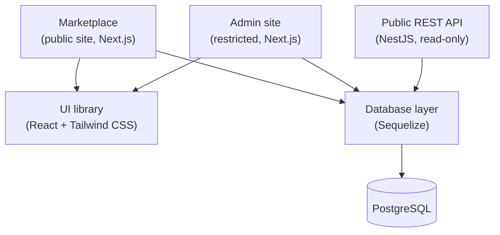

# Tcg Market

> An experimental online marketplace for trading cards and other collectibles, built to explore full-stack ideas around usability and performance.

**Status:** Early development (project setup / proof-of-concept phase).

---

## The Idea

A marketplace where individuals can buy and sell collectible items and related products. **Not** meant to become a standalone product. It's a personal experiment with two goals:

1. **Learn:** deepen my full-stack development skills by building a realistic, multi-app system end to end.
2. **Prototype:** a sandbox for trying out different ideas, building on the interfaces of existing marketplaces while exploring ways to improve UX.

---

## Architecture

The system is a monorepo (npm workspaces) made up of three applications and two shared packages.



### Components

| Component                              | Description                                                                                                | Tech                           | Access                |
|----------------------------------------|------------------------------------------------------------------------------------------------------------|--------------------------------|-----------------------|
| **Marketplace**                        | Public site where users browse, sell and buy products, and manage listings                      | Next.js, i18n                  | Public                |
| **Admin site**                         | Management interface                                                  | Next.js, i18n                  | Restricted            |
| **API**                                | Shares market data with third parties                                                                      | NestJS                         | Restricted, read-only |
| **UI library** (shared)                | Common components used by both frontends                                                                   | React, Tailwind CSS, Storybook | Internal              |
| **Database layer** (`packages/database`) | Standardized access to the database for the sites and the API: models, migrations, seed scripts, validation | Sequelize, PostgreSQL, Zod     | Internal              |

### Key design decisions

- **Monorepo with npm workspaces:** the apps and shared packages evolve together and share code easily.
- **Shared database layer:** one place for models, validation and the public interface, so the sites and the API all access data the same way.
- **Separate public and admin frontends:** different authorization levels, restricted access.
- **Read-only public Rest API:** third parties can consume market data without any write access.

---

## Current Focus

I'm in the project setup phase, getting each package into shape.

| Package | State |
|---------|-------|
| **Database** | Postgres dev environment in Docker, initial migrations, a few models, and scripts to populate test data. Working on data validation and a public interface for other packages. |
| **UI library** | A small set of React + Tailwind CSS components with a basic Storybook setup. |
| **Marketplace / Admin** | Next.js apps running, with internationalization enabled. |
| **API** | NestJS project with a single endpoint to test database access. |

### Next milestone: proof of concept

The goal is a working end-to-end flow where both sites read and write data (with different authorization levels) and the API is read-only:

1. Create a product on the admin site.
2. Display the new product on the Marketplace product page.
3. Create listings for that product on the marketplace. 
4. Use the API to query the count of active listings using the product id.

Unit and end-to-end tests covering the flow.

---

## Roadmap

- [x] Monorepo setup with npm workspaces
- [x] Dev database (Docker + Postgres), initial migrations and seed scripts
- [x] Basic UI components and Storybook
- [x] Next.js apps with i18n, NestJS project skeleton
- [ ] Database validation and public interface
- [ ] Authorization levels (public vs. admin data)
- [ ] Proof-of-concept flow (create product -> product page → listing → API)
- [ ] Unit and end-to-end tests
- [ ] Explore usability and performance ideas (the reason this project exists)

---

## Getting Started

> Not much runnable code is published yet. Setup instructions will be added as the project stabilizes.

```bash
git clone https://github.com/<user>/<repo>.git
cd <repo>
npm install
```

---

## Repository Layout

```
.
├── apps/ (or packages/)
│   ├── marketplace/     # Public Next.js site
│   ├── admin/           # Restricted Next.js site
│   └── api/             # NestJS public API
├── packages/
│   ├── database/        # Sequelize models, migrations, seeds
│   └── ui/              # Shared React + Tailwind components
└── README.md
```

---

## Contributing

This is a personal learning project, but feedback and ideas are welcome. Feel free to open an issue.

## License

Licensed under the GNU General Public License v2 (GPL-2.0).